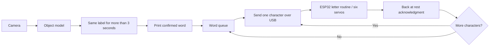

The camera can now send each confirmed label to your ESP32 one character at a
time. For example, `pens` produces four independent serial commands:

```text
p\n
e\n
n\n
s\n
```

Each command runs the existing firmware's single-letter routine. The computer
waits for `Showing <letter> on channels: ...` followed by `Back at rest.` before
sending the next character. It does not recompile or reflash for each letter.

Your `braile_training.txt` is Arduino C++ firmware, not a Python program. An
identical Arduino sketch is provided at
`firmware/braille_serial/braille_serial.ino`. Its contents match your file byte
for byte. The copy under `data/braile_training.txt` is not a separate running
program. The firmware remains responsible for Braille letter patterns and
servo control.

Setup:

1. If your ESP32 already runs `braile_training.txt`, keep that firmware.
   Otherwise open `firmware/braille_serial/braille_serial.ino` in Arduino IDE,
   select your ESP32 board and port, install **Adafruit PWM Servo Driver
   Library** and its required dependencies, and upload the sketch once.
2. Connect the ESP32 to this computer over USB and use the existing PCA9685
   wiring and servo power arrangement from your working setup. The sketch
   retains I2C address `0x40`, SDA GPIO 6, SCL GPIO 7, and 50 Hz PWM. These pin
   settings must match your particular ESP32 board and wiring.
3. Close Arduino Serial Monitor so this application can own the serial port.
4. Install dependencies and list ports:

```bash
.venv/bin/python -m pip install -r requirements.txt
.venv/bin/python braille_output.py --list-ports
```

Test one word independently of the camera:

```bash
.venv/bin/python braille_output.py --port auto --word pens
```

Run the complete workflow:

```bash
.venv/bin/python detect.py --braille-port auto
```

If there are multiple USB serial devices, give the ESP32 port explicitly:

```bash
.venv/bin/python detect.py --braille-port /dev/cu.usbmodemYOUR_PORT
```

On Linux the port often looks like `/dev/ttyUSB0` or `/dev/ttyACM0`; on Windows
it is usually `COM3` or another COM port. `auto` selects a single USB serial
candidate and excludes Bluetooth ports; it cannot authenticate the physical
board. The firmware prompt verifies protocol compatibility before letters are
sent. An unsupported `?` command requests that prompt without selecting a
Braille pattern.

The workflow is:



The detection lock lasts 100 seconds. Serial work happens in a
background thread, so displaying a long word does not freeze the camera or
countdown. The screen shows the current Braille word, character, and position.
The original firmware holds each character for three seconds and includes
additional positioning/rest delays; displaying a complete word can therefore
take longer than the detection lock.

Only confirmed labels that are printed to stdout are submitted. Words never
interleave. Reconfirming the same word while it is active or queued does not
queue a duplicate. Up to three different words may wait behind the active
word. If that queue is full, the new word is rejected and reported rather than
silently replacing an earlier one. Uppercase labels are lowered and underscores
become spaces. Spaces produce a short gap between words, with the previous
character already at rest. The firmware handles a-z; unsupported punctuation,
digits, and non-ASCII letters are rejected before any characters are sent.

The channel and pulse mappings are preserved:

| Braille dots | PCA9685 channels | Rest pulse | Display pulse |
| --- | --- | --- | --- |
| 1, 2, 3 (left column) | 0, 1, 2 | 2000 us | 1000 us |
| 4, 5, 6 (right column) | 6, 5, 4 | 1000 us | 2000 us |

A per-character timeout defaults to 15 seconds and can be changed with
`--braille-timeout`. A timeout, disconnection, wrong-character acknowledgment,
board restart, or PCA9685 error stops the serial queue. Characters are not
automatically retried because the computer may not know whether a timed-out
character was already shown. Restart the application after correcting the
connection. Quitting the camera cancels remaining queued characters; the
firmware's currently running letter routine may still finish and return to
rest on its own.

When telemetry is enabled, the application logs queued/started/completed words,
character acknowledgments, firmware-reported channels, command-cycle elapsed
time, and errors to the local outbox. Tiger Data sync handles those events like
the other capture events. Command-cycle time includes deliberate display and
rest delays. It is **not measured servo movement latency** or evidence of
physical position feedback. The existing reading-rate suggestions and busy
scene output plans remain telemetry features; this firmware keeps its own
three-second display timing and receives confirmed product labels directly.

Dry-run checks without an ESP32:

```bash
.venv/bin/python braille_output.py --dry-run --word pens
.venv/bin/python detect.py --braille-dry-run
.venv/bin/python -m unittest test_braille_output test_detection test_black_pen_data test_tiger_data
```

Dry runs explicitly mark their events as simulated and never claim a hardware
acknowledgment. Protocol and queue tests use fake serial connections; the
camera-loop test verifies that words are queued only after confirmation and
that inference resumes after the 100-second lock. Physical servo operation and
flashing still require a connected ESP32. No USB ESP32 port was detected during
implementation, so no physical movement or board upload was performed.

References: [pySerial API](https://pyserial.readthedocs.io/en/stable/pyserial_api.html),
[Adafruit PWM Servo Driver Library](https://github.com/adafruit/Adafruit-PWM-Servo-Driver-Library).
